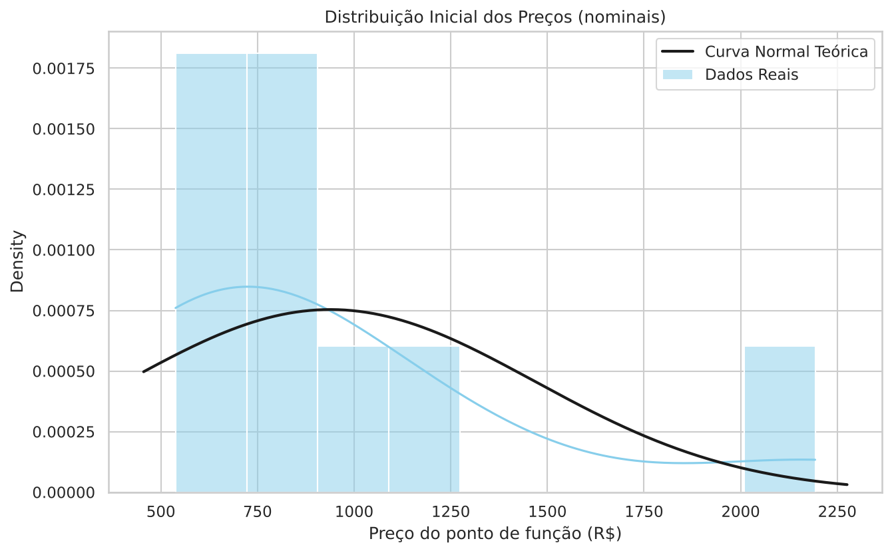
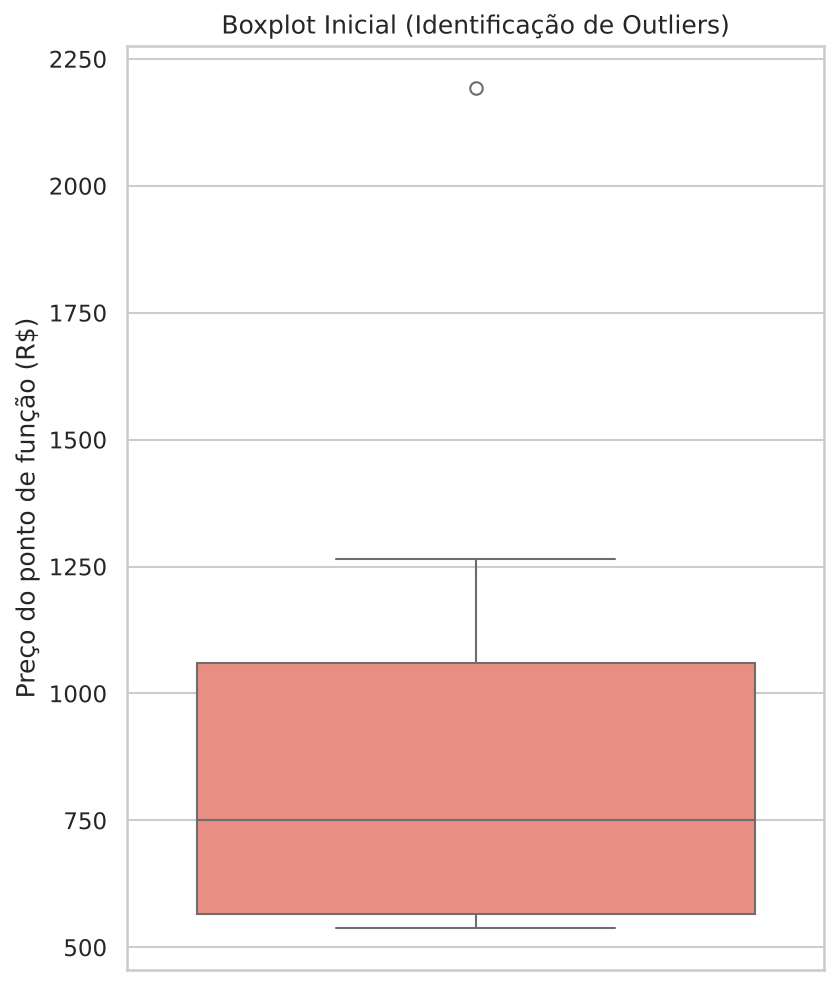
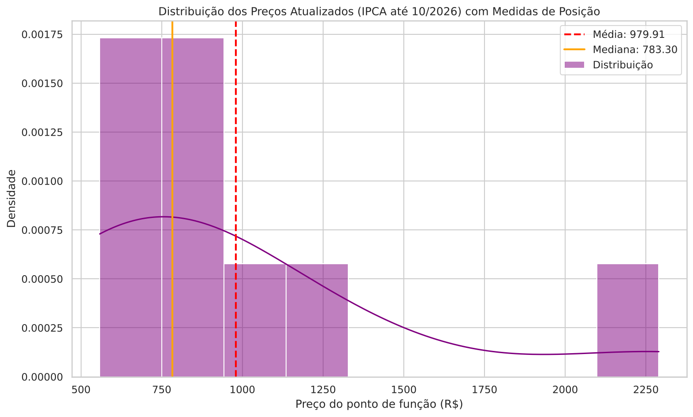
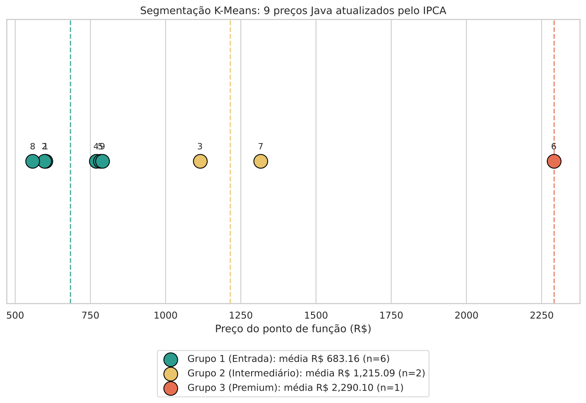
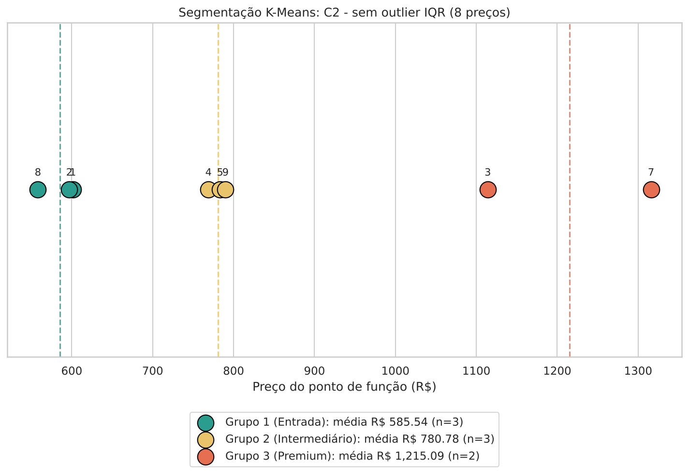
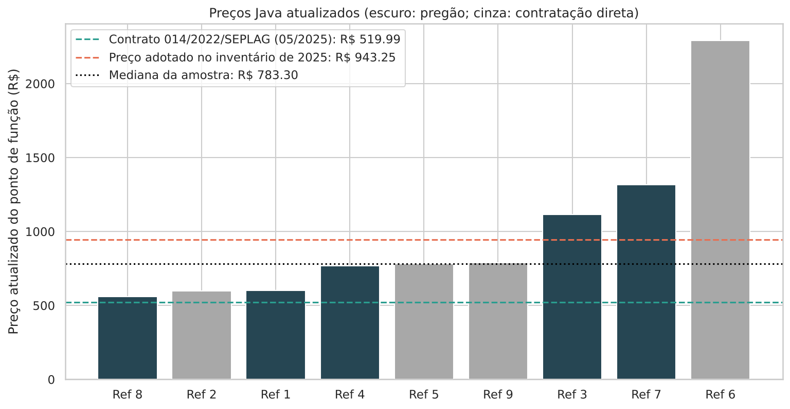

# PESQUISA, TRATAMENTO E ANÁLISE ESTATÍSTICA DE PREÇOS DE MERCADO PARA REFERÊNCIA DO VALOR ESTIMADO DO PONTO DE FUNÇÃO - EXERCÍCIO 2026

Cuiabá/MT, 16/11/2026.

## 1. INTRODUÇÃO E OBJETIVO DO ESTUDO

O presente estudo técnico tem por finalidade a pesquisa, o tratamento e a análise estatística de preços de mercado do ponto de função, para subsidiar a escolha do preço de referência a ser usado na avaliação dos softwares desenvolvidos internamente, no Inventário de Bens Intangíveis do exercício de 2026 da SEPLAG/MT (IN Conjunta nº 003/2022/SEPLAG/SEFAZ, art. 11, § 3º, e Portaria nº 124/2026/SEPLAG).

O estudo apresenta os grupos de preços e as evidências. A escolha do preço de referência cabe à presidência da comissão e será registrada e motivada no Relatório Final.

## 2. OBJETO DE REFERÊNCIA E JUSTIFICATIVA TÉCNICA

O objeto de referência é o Contrato nº 014/2022/SEPLAG, firmado por adesão à Ata de Registro de Preços nº 033/2021 da Procuradoria-Geral de Justiça do Tocantins: serviço técnico especializado, continuado, na modalidade de fábrica de software para sustentação, manutenção, desenvolvimento e melhorias de sistemas, medido em ponto de função. O preço contratado foi de R$ 457,00 por ponto de função em 05/2022 e de R$ 519,99 após o quarto apostilamento, em 05/2025.

A tecnologia Java é a padronizada e predominante nos sistemas mantidos pela SITEC. Por isso a amostra foi restrita a serviços em Java medidos em ponto de função.

## 3. METODOLOGIA DE COLETA E CURADORIA DE DADOS

A coleta foi feita em 16/11/2026 na API oficial de Dados Abertos do Compras.gov.br, módulo de preços praticados, para os 14 códigos do Catálogo de Serviços do grupo 111 (desenvolvimento e manutenção de software), com data de compra entre 01/01/2025 e 16/11/2026. O fundamento é o Decreto Estadual nº 1.525/2022, que admite contratações similares da Administração Pública e sistemas oficiais de governo como parâmetros de pesquisa.

| Etapa | Registros |
|---|---:|
| Preços praticados nos 14 códigos | 683 |
| Com unidade de medida ponto de função | 92 |
| Descartados por quantidade ou preço incompatível com contratação por ponto de função | 31 |
| Outras linguagens (comparação) | 52 |
| Java, medido em ponto de função (amostra) | 9 |

### 3.1. Tratamento da Amostra

Cada preço foi vinculado à compra de origem pelo identificador da compra, pelo número de controle do PNCP e pelo processo administrativo. A rastreabilidade completa está na planilha `Mapa_Comparativo_Precos_PF_2026.xlsx` e nas fichas de evidência.

| Ref. | Preço na origem (R$) | Data | Órgão | Modalidade | Dentro de 13 meses |
|---:|---:|---|---|---|---|
| 1 | 555,00 | 17/02/2025 | Casa da Moeda do Brasil | Pregão, registro de preços | Não |
| 2 | 565,15 | 09/06/2025 | Secretaria da Segurança Pública do RN | Inexigibilidade | Não |
| 3 | 1.060,00 | 15/08/2025 | Pagadoria de Pessoal da Marinha | Pregão | Não |
| 4 | 735,00 | 14/11/2025 | Universidade Federal do Cariri | Pregão | Sim |
| 5 | 750,00 | 10/12/2025 | Ministério Público do Pará | Inexigibilidade | Sim |
| 6 | 2.192,73 | 23/12/2025 | INCRA (Serpro) | Dispensa | Sim |
| 7 | 1.264,22 | 07/01/2026 | Tribunal de Justiça do Pará | Pregão | Sim |
| 8 | 538,00 | 26/02/2026 | Ministério do Desenvolvimento Social | Pregão | Sim |
| 9 | 785,00 | 20/08/2026 | Secretaria da Educação de Salvador | Inexigibilidade | Sim |

Limitações da amostra:

a) Cinco referências vêm de pregão (1, 3, 4, 7 e 8). As referências 2, 5 e 9 são inexigibilidade e a 6 é dispensa, sem disputa de preço.

b) A referência 7 é pregão para fornecimento e implantação de solução, em que o ponto de função é item acessório.

c) As referências 1, 2 e 3 têm mais de 13 meses na data da pesquisa.

d) Da pesquisa de 2025, nenhum dos 13 preços atende à janela de 13 meses. A contratação da Marinha (R$ 1.060,00) já integra a amostra como referência 3.

## 4. ANÁLISE EXPLORATÓRIA DE DADOS - SEM ATUALIZAÇÃO MONETÁRIA

### 4.1. Estatísticas Descritivas

| Medida | Valor (R$) |
|---|---:|
| Média | 938,34 |
| Mediana | 750,00 |
| Desvio padrão | 529,31 |
| Moda | não há valor repetido |

A média é 25% superior à mediana.

### 4.2. Detecção de Outliers (Método IQR)

| Parâmetro | Valor (R$) |
|---|---:|
| Primeiro quartil (Q1) | 565,15 |
| Terceiro quartil (Q3) | 1.060,00 |
| Intervalo interquartil (IQR) | 494,85 |
| Limite superior de aceitação | 1.802,28 |

O teste identificou um outlier: a referência 6 (R$ 2.192,73), contratação direta do Serpro pelo INCRA. Sem ela, a média cai para R$ 781,55 e a mediana para R$ 742,50.

## 5. ATUALIZAÇÃO MONETÁRIA COM O IPCA/IBGE

Cada preço foi corrigido pelo IPCA (série 433 do Banco Central do Brasil) do mês da compra até 10/2026, último índice publicado na data do estudo. O método é o mesmo da ferramenta de atualização monetária usada em 2025.

| Ref. | Preço na origem (R$) | Mês-base | Fator IPCA | Preço atualizado (R$) |
|---:|---:|---|---:|---:|
| 1 | 555,00 | 02/2025 | 1,083626 | 601,41 |
| 2 | 565,15 | 06/2025 | 1,056356 | 597,00 |
| 3 | 1.060,00 | 08/2025 | 1,051094 | 1.114,16 |
| 4 | 735,00 | 11/2025 | 1,046284 | 769,02 |
| 5 | 750,00 | 12/2025 | 1,044404 | 783,30 |
| 6 | 2.192,73 | 12/2025 | 1,044404 | 2.290,10 |
| 7 | 1.264,22 | 01/2026 | 1,040968 | 1.316,01 |
| 8 | 538,00 | 02/2026 | 1,037545 | 558,20 |
| 9 | 785,00 | 08/2026 | 1,006381 | 790,01 |

Com os valores atualizados, a média é de R$ 979,91 e a mediana de R$ 783,30. O teste IQR continua apontando apenas a referência 6 como outlier (limite superior de R$ 1.883,29).

### 5.1. Segmentação dos Preços com K-Means

Os preços atualizados foram agrupados em três grupos pelo algoritmo K-Means, como em 2025. O K-Means é um método de agrupamento não supervisionado, que separa os dados pela distância entre os preços.

**Cenário principal: os 9 preços**

| Grupo | Referências | Faixa (R$) | Média (R$) |
|---|---|---|---:|
| Grupo 1 (Entrada) | 1, 2, 4, 5, 8, 9 | 558,20 a 790,01 | 683,16 |
| Grupo 2 (Intermediário) | 3, 7 | 1.114,16 a 1.316,01 | 1.215,09 |
| Grupo 3 (Premium) | 6 | 2.290,10 | 2.290,10 |

Neste cenário a referência 6 ocupa sozinha o Grupo 3, seis dos nove preços ficam no Grupo 1 e o Grupo 2 tem dois preços.

**Cenário sem o outlier: 8 preços**

| Grupo | Referências | Faixa (R$) | Média (R$) |
|---|---|---|---:|
| Grupo 1 (Entrada) | 1, 2, 8 | 558,20 a 601,41 | 585,54 |
| Grupo 2 (Intermediário) | 4, 5, 9 | 769,02 a 790,01 | 780,78 |
| Grupo 3 (Premium) | 3, 7 | 1.114,16 a 1.316,01 | 1.215,09 |

Índice de silhueta de 0,80, contra 0,64 no cenário com 9 preços.

### 5.2. Cenários de Sensibilidade

| Cenário | Preços | Média (R$) | Mediana (R$) | Grupo 1 (R$) | Grupo 2 (R$) | Grupo 3 (R$) |
|---|---:|---:|---:|---:|---:|---:|
| C1 - 9 preços | 9 | 979,91 | 783,30 | 683,16 | 1.215,09 | 2.290,10 |
| C2 - sem o outlier | 8 | 816,14 | 776,16 | 585,54 | 780,78 | 1.215,09 |
| C3 - janela de 13 meses | 6 | 1.084,44 | 786,65 | 725,13 | 1.316,01 | 2.290,10 |
| C4 - apenas pregões | 5 | 871,76 | 769,02 | 579,81 | 769,02 | 1.215,09 |

Os valores dos grupos são os centroides. Nos cenários C3 e C4 há grupos com um único preço.

## 6. RESULTADOS PARA A DECISÃO

Este estudo não indica o preço de referência. Ele entrega os grupos formados pelo algoritmo e as evidências de cada preço. A escolha do grupo ou do preço, inclusive a de manter, excluir ou adotar o valor apontado como outlier, é decisão da presidência da comissão, a ser motivada no Relatório Final.

### 6.1. Grupos formados em cada cenário

O valor representativo de cada grupo no K-Means é o seu centroide, que corresponde à média dos preços do grupo. A tabela traz também a mediana, o mínimo e o máximo, para que a leitura não dependa só da média.

| Cenário | Grupo | Referências | Mínimo (R$) | Mediana (R$) | Centroide (R$) | Máximo (R$) |
|---|---|---|---:|---:|---:|---:|
| C1 - 9 preços | Grupo 1 | 1, 2, 4, 5, 8, 9 | 558,20 | 685,21 | 683,16 | 790,01 |
| C1 - 9 preços | Grupo 2 | 3, 7 | 1.114,16 | 1.215,09 | 1.215,09 | 1.316,01 |
| C1 - 9 preços | Grupo 3 | 6 | 2.290,10 | 2.290,10 | 2.290,10 | 2.290,10 |
| C2 - sem o outlier | Grupo 1 | 1, 2, 8 | 558,20 | 597,00 | 585,54 | 601,41 |
| C2 - sem o outlier | Grupo 2 | 4, 5, 9 | 769,02 | 783,30 | 780,78 | 790,01 |
| C2 - sem o outlier | Grupo 3 | 3, 7 | 1.114,16 | 1.215,09 | 1.215,09 | 1.316,01 |
| C3 - janela de 13 meses | Grupo 1 | 4, 5, 8, 9 | 558,20 | 776,16 | 725,13 | 790,01 |
| C3 - janela de 13 meses | Grupo 2 | 7 | 1.316,01 | 1.316,01 | 1.316,01 | 1.316,01 |
| C3 - janela de 13 meses | Grupo 3 | 6 | 2.290,10 | 2.290,10 | 2.290,10 | 2.290,10 |
| C4 - apenas pregões | Grupo 1 | 1, 8 | 558,20 | 579,81 | 579,81 | 601,41 |
| C4 - apenas pregões | Grupo 2 | 4 | 769,02 | 769,02 | 769,02 | 769,02 |
| C4 - apenas pregões | Grupo 3 | 3, 7 | 1.114,16 | 1.215,09 | 1.215,09 | 1.316,01 |

### 6.2. Fatos verificados

a) O teste IQR aponta a referência 6 (R$ 2.290,10 atualizado) como outlier, nos valores nominais e nos atualizados.

b) Com os 9 preços, a referência 6 forma sozinha o Grupo 3.

c) Sem a referência 6, os três grupos têm 3, 3 e 2 preços, e o índice de silhueta sobe de 0,64 para 0,80.

d) O preço adotado em 2025 (R$ 943,25) fica acima de sete e abaixo de dois dos nove preços atualizados.

e) O contrato vigente da SEPLAG (R$ 519,99 em 05/2025) fica abaixo dos nove preços.

f) Quatro das nove referências são contratações diretas (2, 5, 6 e 9).

g) Três das nove referências têm mais de 13 meses (1, 2 e 3).

### 6.3. Limitações que afetam a robustez

a) A amostra tem 9 preços. Com esse tamanho, o agrupamento é sensível à entrada ou saída de um único preço, como mostram os cenários, e há grupos com um ou dois preços.

b) O índice de silhueta mede a separação entre os grupos, não a qualidade do preço.

c) Os preços vêm do resultado das compras registrado na API oficial. O edital, a ata e o contrato de cada referência ainda não foram juntados.

d) Os contratos de fábrica de software diferem em escopo, níveis de serviço e exigência de perfis, o que explica parte da dispersão e não é corrigido pela análise.

### 6.4. Ordem de grandeza do efeito sobre o inventário

Estimativa com o mesmo tamanho funcional (26.660 pontos de função) e os mesmos valores institucionais de 2025, quando o grupo de softwares desenvolvidos internamente foi avaliado em R$ 44.976.518,13 ao preço de R$ 943,25. Deve ser recalculada com as medições de 2026.

| Preço (R$) | Origem do valor | Valor estimado do grupo (R$) | Variação sobre 2025 |
|---:|---|---:|---:|
| 585,54 | C2, Grupo 1 | 27.920.011,05 | -37,9% |
| 683,16 | C1, Grupo 1 | 32.574.776,70 | -27,6% |
| 780,78 | C2, Grupo 2 | 37.229.542,35 | -17,2% |
| 943,25 | Preço de 2025 | 44.976.518,13 | 0,0% |
| 1.215,09 | C1, Grupo 2 ou C2, Grupo 3 | 57.938.528,93 | +28,8% |
| 2.290,10 | C1, Grupo 3 (referência 6) | 109.197.693,26 | +142,8% |

**Valor de referência do ponto de função para 2026:** a definir pela presidência da comissão no Relatório Final.

## ANEXO I - EVIDÊNCIAS

As evidências de cada preço estão na pasta `3. Evidências`: ficha em PDF e print por referência, com o preço homologado, o objeto, o fornecedor, o processo, o número de controle PNCP e os links da origem. Os dados brutos da coleta e o registro das consultas estão em `2. Coleta de Dados/Dados_Brutos`.

## ANEXO II - REPRODUÇÃO DA ANÁLISE

O notebook `Analise_Precos_PF-2026.ipynb`, na pasta `5. Análise Estatística`, reproduz todos os cálculos e gráficos deste estudo a partir do arquivo `Precos_Ponto_Funcao_2025-2026.csv`.

Elaboração:

Jonathas G. Marques

Gerente de projetos e cientista de dados (CPPTI/SITEC/SAAS/SEPLAG)

Matrícula: 280193
